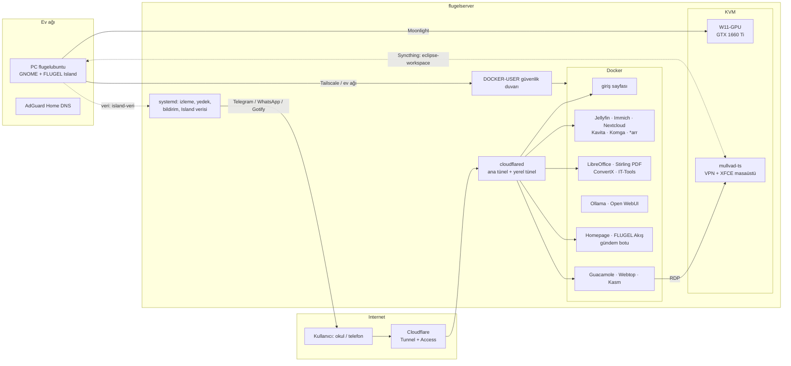

# Mimari

Tek bir fiziksel sunucu (flugelserver) üzerinde üç katman çalışır:

1. **Ana sistem (Ubuntu 26.04):** diskler, ağ, güvenlik duvarı, Docker, libvirt/KVM, Tailscale, iki Cloudflare tüneli,
   izleme/yedek/bildirim betikleri (systemd zamanlayıcıları).
2. **Docker yığınları (~37):** medya, fotoğraf, dosya, ofis, yapay zekâ, panel ve akış, uzak masaüstü servisleri.
   Her yığın `/opt/stacks/<ad>/compose.yaml`; veriler `/mnt/sidemain` ve `/mnt/side` disklerinde.
3. **Sanal makineler (KVM):** GPU'lu Windows (oyun/akış), GPU'suz Windows, VPN + geliştirme masaüstü (mullvad-ts).

## Veri akışları

- **Erişim:** internetten yalnız Cloudflare tüneli üzerinden (sunucuda gelen port açık değil). Ev ağı ve Tailscale
  doğrudan erişir. Ayrıntı: [AG-VE-ERISIM.md](AG-VE-ERISIM.md).
- **Bildirim:** betikler `bin/bildirim` ile Telegram'a ve bir kayıt dosyasına yazar; PC (FLUGEL Island) bu kaydı
  okuyup masaüstünde gösterir. Ayrıntı: [IZLEME-VE-BILDIRIM.md](IZLEME-VE-BILDIRIM.md).
- **Island verisi:** `sbin/island-veri.py` 20 sn'de bir sunucu durumunu JSON'a yazar; FLUGEL Akış API'si bunu
  `/api/island` olarak verir, PC'deki GNOME eklentisi okur.
- **Yedek:** kritik veriler ikinci diske, silinenler 30 gün saklanır. Ayrıntı: [YEDEKLEME.md](YEDEKLEME.md).

## Belgeler

| Belge | Konu |
| --- | --- |
| [AG-VE-ERISIM.md](AG-VE-ERISIM.md) | ağ, tüneller, DNS, güvenlik duvarı, hangi servis nereden açılır |
| [DEPOLAMA.md](DEPOLAMA.md) | diskler, şifreleme, bağlama noktaları, disk koruma |
| [YEDEKLEME.md](YEDEKLEME.md) | ne, nereye, ne sıklıkta yedeklenir; geri yükleme |
| [IZLEME-VE-BILDIRIM.md](IZLEME-VE-BILDIRIM.md) | sağlık izleme, kendini onarma, raporlar, bildirim kanalları |
| [GUVENLIK.md](GUVENLIK.md) | tehdit modeli, korumalar, depodaki temizlik |
| [SANAL-MAKINELER.md](SANAL-MAKINELER.md) | GPU geçirme, Windows, mullvad-ts |
| [UZAK-MASAUSTU.md](UZAK-MASAUSTU.md) | Guacamole, Webtop, Kasm, tek oturum, boşta kapanma |
| [KURULUM.md](KURULUM.md) | sıfırdan yeniden kurulum sırası |
| [BAKIM.md](BAKIM.md) | günlük işler, güncelleme, sorun giderme |
| [otomatik/](otomatik/) | dosyalardan üretilen tablolar: yığınlar, servisler, betikler, sanal makineler, tünel |
